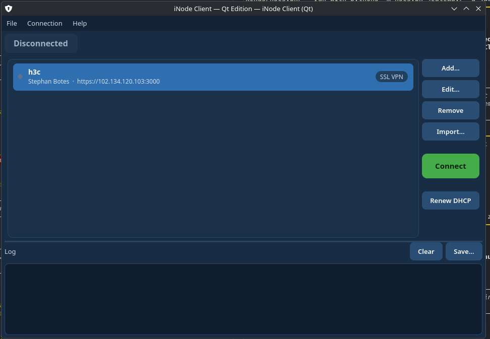

# iNode VPN Client — Full-Source Repository

An open-source, interoperable VPN client that speaks the **H3C iNode** protocol suite. Provides a Qt6/KF6 desktop GUI and a standalone CLI backend for the H3C SSL VPN ("V7"), plus 802.1X, L2TP/IPSec, Portal, EAD posture, and Zero-Trust SPA — all 100% FOSS.



## What this is

A complete, working alternative to the proprietary **H3C iNode Intelligent Client** (closed-source, ~71 MB, Qt5, Ubuntu-only, bundles ancient OpenSSL 1.1). This project:

- **Speaks the same wire protocols** (reverse-engineered from the official unstripped Linux client).
- **Runs anywhere** Qt6/KF6 + Python 3.9+ run — Kali, Fedora, Arch, Debian, openSUSE, ARM.
- **Is fully open-source** (GPL-3.0 for Qt/C++, MIT for the Python backend).
- **Contains no vendor code** — all original, clean-room reimplementation.

## Protocols

| Protocol | Status | Backend |
|---|---|---|
| **802.1X** (wired HC-CHAPv2) | Working | `minieap` / `mentohust` |
| **WLAN** (wireless 802.1X) | Working | NetworkManager + 802.1X |
| **Portal v2** (GB/T 28181) | Working | Native Qt UDP client |
| **L2TP/IPSec** | Working | strongSwan + xl2tpd |
| **SSL VPN** (H3C SVPN "V7") | Working | `backends/h3csvpn` (Python, clean-room) |
| **EAD posture** | Implemented (untested vs live iMC) | Native UDP/9019 SEC protocol |
| **H3C Portal** (proprietary) | Experimental (faithful framing) | Native Qt UDP, H3C opcode/attr set |
| **SDP** (Zero-Trust) | Experimental (SPA knock + SSL VPN) | RFC-4226 HOTP knock builder |

## Quick start

### One command (recommended)

```bash
./deploy.sh
```

That detects your distro, installs build/runtime deps (apt/dnf/pacman/zypper),
builds, installs system-wide (`/usr/local/bin` + `/usr/libexec/iNodeClient-Qt`
+ polkit policy + menu entry), and finishes with an environment `--doctor`
report.

```bash
./deploy.sh --local      # portable build into ./bin — no root, run ./iNode-VPN.sh
./deploy.sh --build-only # just build
./deploy.sh --uninstall  # remove the system install (user data kept)
./deploy.sh --doctor     # environment report only
```

### GUI (manual)

```bash
# Build
mkdir -p build && cd build
cmake .. -DCMAKE_BUILD_TYPE=RelWithDebInfo
# Use -j1 or -j2 if system memory is low to avoid OOM during parallel build
cmake --build . -j$(nproc)
cp iNodeClient-Qt ../bin/

# Run
../iNode-VPN.sh
```

### CLI — SSL VPN only (no GUI, pure Python)

```bash
# The package lives in backends/ — the wrapper below handles PYTHONPATH:
# Authenticate only (no tunnel, no root):
./svpn-connect.sh --auth-only vpn.example.com:3000 alice RADIUS

# Full connection (TUN device, needs root):
./svpn-connect.sh vpn.example.com:443 alice RADIUS

# Direct invocation (PYTHONPATH must include backends/):
PYTHONPATH=backends python3 -m h3csvpn vpn.example.com:443 -u alice -d RADIUS
```

### GUI + tunnel

```bash
./iNode-VPN.sh      # launches the Qt GUI
```

## Repository layout

```
├── src/                    Qt6/KF6 C++ source (the GUI application)
│   ├── main.cpp            App entry, CLI, auto-connect
│   ├── MainWindow.{h,cpp}  Profile list + connection UI + tray
│   ├── core/               Profile store, credential vault, auto-reconnect, etc.
│   ├── protocols/          Per-protocol plugins (802.1X, L2TP, SSL VPN, Portal, EAD)
│   ├── ui/                 Theme manager, tray icon, stats pane, log pane
│   └── resources/          Icons, stylesheets, polkit policy, .desktop file
│
├── backends/h3csvpn/       Pure-Python SSL VPN client (clean-room, ~2000 LOC)
│   ├── protocol.py         XML builders/parsers (byte-exact with the original)
│   ├── session.py          Auth orchestration (TLS → gatewayinfo → CAPTCHA → login → tunnel)
│   ├── captcha.py          CAPTCHA auto-solver (pure BMP decode + tesseract OCR)
│   ├── tunnel.py           4-byte frame codec + heartbeat + TUN<->TLS pump
│   ├── vnic.py             Virtual NIC (TUN ioctl + ip routes + resolv.conf)
│   ├── transport.py        TLS setup / certificate pinning / client certs
│   ├── httpclient.py       Minimal HTTP/1.1 over TLS socket
│   ├── crypto.py           URL-encoding, HOTP (RFC 4226), optional RSA
│   ├── spa.py              Zero-Trust SPA knock (47-byte UDP packet)
│   ├── safexml.py          XXE/entity-hardened XML parsing
│   └── constants.py        All recovered wire protocol constants
│
├── scripts/                Privileged helpers (pkexec/polkit)
│   ├── inode-svpn-helper   SSL VPN tunnel (TUN device, routes, DNS)
│   ├── inode-dot1x-helper  minieap/mentohust wrapper
│   ├── inode-l2tp-helper   strongSwan + xl2tpd config writer
│   └── inode-ipcfg-helper  Static IP address/route/DNS programmer
│
├── docs/                   Protocol specs, security findings, CAPTCHA analysis
│   ├── PROTOCOL.md         Full reverse-engineered wire protocol spec (871 lines)
│   ├── PROTOCOLS.md        Implementation status for all protocol plugins
│   ├── SECURITY-FINDINGS.md  Audit findings (protocol + implementation)
│   ├── CAPTCHA.md          CAPTCHA analysis and OCR methodology
│   └── INTEROP.md          Interoperability notes vs live gateway
│
├── re/                     Reverse engineering reference (protocol facts, no binaries)
│   ├── out/PROTOCOL.md     Full wire protocol specification
│   └── findings/           Per-component RE notes (crypto, tunnel, HTTP, SPA, etc.)
│
├── iNode-VPN.sh            Launch the GUI
├── deploy.sh               One-shot build+install (see Quick start)
├── svpn-connect.sh         Quick CLI SSL VPN connect
├── i18n/                   Translation scaffolds (en, zh_CN, ja)
└── CHANGELOG.md            Full change history
```

## Build requirements

### GUI (Qt/C++)

```bash
# Debian / Kali Linux / Ubuntu:
sudo apt install qt6-base-dev cmake g++ tesseract-ocr
# Optional, for KDE integration:
sudo apt install libkf6wallet-dev libkf6config-dev libkf6i18n-dev libkf6coreaddons-dev
```

### SSL VPN backend (Python)

```bash
# Core: pure Python 3.9+ stdlib (no deps required)
python3 -m h3csvpn --help

# Recommended extras:
pip install -r backends/h3csvpn/requirements-dev.txt
# or: pip install backends/h3csvpn/[secure,rsa,test]
```

### Runtime dependencies

| Feature | Required |
|---|---|
| 802.1X | `minieap` (preferred) or `mentohust` |
| WLAN | NetworkManager (`nmcli`) |
| L2TP/IPSec | `strongswan`, `xl2tpd`, `ppp`, `polkit` |
| SSL VPN | `python3` (stdlib), `tesseract` (for CAPTCHA OCR) |
| Secure credentials | KWallet or freedesktop Secret Service (gnome-keyring, etc.) |

## How the SSL VPN works

The protocol was reverse-engineered from the official H3C iNode 7.3 Linux client (unstripped, DWARF-symbols). The full wire protocol specification is at `docs/PROTOCOL.md`.

Flow: *(optional SPA knock)* → **TLS** → `GET /svpn/index.cgi` → parse capabilities/domains → *(CAPTCHA)* → `POST request=<urlencoded login XML>` → *(challenge/2FA loop)* → kick-old → **NET_EXTEND** on fresh TLS socket → network-config frame → program TUN/routes/DNS → raw IP packets in 4-byte frames + heartbeat → `GET /svpn/logout.cgi`.

## Security

- TLS verification is **on by default**; `--insecure` is opt-in and warns loudly.
- Certificate pinning (`--pin-sha256`) is the recommended way to trust self-signed gateways.
- Password is cleartext inside TLS (the standard V7 path); confidentiality relies entirely on TLS.
- Gateway responses are untrusted: XML parsing is hardened against XXE / entity expansion.
- **Credential storage backends** (auto-selected, shown by `--doctor`):
  KWallet → freedesktop Secret Service → **system GnuPG** → AES-256-GCM file.
  - The **GPG backend** seals saved credentials to your own GPG key (or
    symmetric, pinentry-prompted, if you have no key). gpg-agent owns the
    passphrase — this app never sees it, and unlocks are cached by the agent
    like any other GPG use:
    ```bash
    gpg --full-gen-key          # once, if you don't have a key
    ./deploy.sh                 # deploy; the client picks GPG up automatically
    ./bin/iNodeClient-Qt --doctor   # verify: [ok] GnuPG — GPG (key 7C1C…)
    ```
- Plaintext secrets never touch disk; privileged helpers are newline-injection
  hardened and validated at every trust boundary.
- See `docs/SECURITY-FINDINGS.md` for the full audit.

## Testing

```bash
# Sanity-check the SSL VPN backend module loads (note: the package lives in
# backends/, so point PYTHONPATH there — the shell wrappers do this for you):
PYTHONPATH=backends python3 -m h3csvpn --help

# Authenticate against a real gateway without a tunnel (no root):
./svpn-connect.sh --auth-only <gateway>:<port> <user> <domain>
```

## License

- **Qt/C++ application**: GPL-3.0-or-later (see `LICENSE`)
- **Python SSL VPN backend** (`backends/h3csvpn/`): MIT (see `backends/h3csvpn/LICENSE.MIT`)

This is an independent interoperability implementation. It is **not affiliated with, endorsed by, or supported by H3C / New H3C Technologies**. "H3C" and "iNode" are trademarks of their respective owners.
